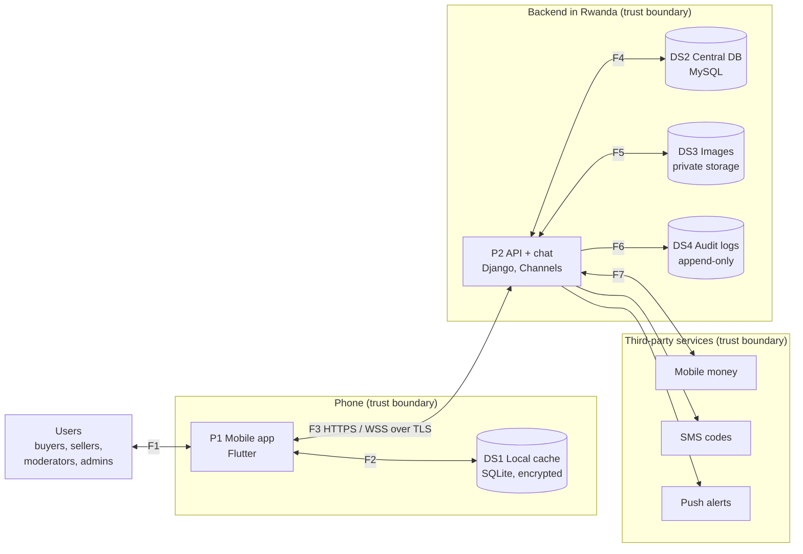

# application-sec-Demo
SokoLink – Secure Local Online Marketplace
SokoLink is a mobile marketplace where people and small businesses in a town can advertise products for sale, chat with buyers, and manage orders.
The project is built with security in every phase of the Software Development Life Cycle (SDLC). It is not added at the end. It was developed for CIS 4163: Application Security Technologies (School of ICT, College of Science and Technology, University of Rwanda).
> **Status (24 Nov 2026):** Requirements ✅ and Design ✅ are complete. Development, Testing, Deployment and Maintenance are planned, and their security activities are already defined. See [Project status](#project-status).
---
Table of contents
Features
User roles
Tech stack
Architecture
Secure SDLC approach
Threat model summary
Security requirements
Security checks in CI
Project status
Roadmap
Repository structure
Getting started
Reporting a vulnerability
References
Author
---
Features
Feature	Description
Product listings	Title, description, price, photos, condition, approximate location
Categories	Electronics, clothing, furniture, food, services, and more
Search	Keyword search with filters for category, price and distance
Seller profiles	Name, photo, ratings and reviews, plus a "verified business" badge for small businesses
Messaging	Private real-time chat between a buyer and a seller about a listing
Order management	Place, confirm, deliver, complete or cancel orders. Payment by mobile money or cash on delivery
User roles
Role	Can do	Cannot do
Buyer	Browse, search, message sellers, place and track orders, review after an order	See other users' orders or chats
Seller	Create and edit own listings, reply to buyers, manage own orders, set a payout number	Edit other sellers' listings or see their orders
Moderator	Review reports, hide listings, approve business badges	Read private chats unless reported
Administrator	Manage accounts, roles, categories and configuration	Change orders or payments without an audited reason
One account can be both a buyer and a seller.
Tech stack
Layer	Technology
Mobile app	Flutter / Dart (Android and iOS), SQLite cache encrypted with SQLCipher
Backend API	Django + Django REST Framework
Real-time chat	Django Channels (secure WebSockets)
Database	MySQL (full-text search for listings)
Image storage	Private object storage, served through short-lived signed links
External services	Mobile money payment API, SMS one-time codes, push notifications
Hosting	Servers in Rwanda (data protection law, Law No. 058/2021)
Architecture
Data flow diagram with trust boundaries. Every flow that crosses a boundary is checked against all six STRIDE threats.

Secure SDLC approach
Each phase has its own security activities and a security gate that must pass before the next phase starts. The structure follows the secure SDLC framework of Humayun et al. (2022).
Phase	Security activities	Security gate	Status
1. Requirements	13 security requirements (CIA), 6 abuse cases, data protection law review	Security requirements signed off	✅ Done
2. Design	Secure design principles, STRIDE threat model (17 threats), MITRE ATT&CK + D3FEND mapping (ISADM method)	Every high risk has a planned control	✅ Done (v1)
3. Development	Secure coding rules, peer review, SAST, dependency and secret scanning	No high findings in scans or review	⏳ Planned
4. Testing	14 security test cases, DAST (OWASP ZAP), mobile scan (MobSF), penetration test	All high-risk threat tests pass	⏳ Planned
5. Deployment	Hardening checklist, TLS, private storage, secrets vault, signed builds, DevSecOps pipeline	Checklist signed off	⏳ Planned
6. Maintenance	Patching, fraud and abuse monitoring, incident response (NIST CSF), maturity reviews	Quarterly security review	⏳ Planned
Threat model summary
Risk = likelihood × impact (each rated 1–5). Following ISADM's score-based threshold, every threat with risk ≥ 12 must be fixed before release. That applies to 14 of the 17 threats.
#	Threat	STRIDE	Planned control	Risk
T1	Fake seller accounts listing items that do not exist	Spoofing	Phone verification, moderated business badge, reviews only after real orders, limits for new sellers	20
T2	Seller account takeover, payout number changed	Spoofing	One-time code on new device and payout change, lockout, alert to old number	16
T3	Reading others' orders or chats by changing an ID	Information disclosure	Ownership check on every request and chat message	16
T4	Buyer changes the price in the order request	Tampering	Server calculates totals from the stored listing	16
T5	Scam payment links sent in chat	Spoofing	Link warnings, in-app payment only, flagged messages	16
T6	Fake or replayed payment callback	Tampering	Verify provider signature, unique payment reference	15
T7	SQL injection in search	Tampering	Django ORM only, input validation	15
T8	Buyer reaches moderator/admin functions	Elevation of privilege	Deny-by-default role checks, admin behind VPN	15
T9	Database leak of phones, addresses, messages	Information disclosure	Encryption at rest, no public DB port, least-privilege DB user	15
T10	Malicious content or files in listings and chat	Tampering	Plain-text display, output encoding, image re-encoding	12
T11	Photo location data reveals a seller's home	Information disclosure	Strip EXIF data on upload	12
T12	User denies an order or message	Repudiation	Order history and append-only audit log	12
T13	Spam bots and SMS code flooding	Denial of service	Rate limits, CAPTCHA, SMS limits	12
T14	Vulnerable third-party packages	Tampering	Pinned versions, dependency scanning	12
T15	Lost phone exposes chats and tokens	Information disclosure	SQLCipher, secure storage, remote logout	9
T16	Man-in-the-middle on public Wi-Fi	Tampering	TLS 1.2+, certificate pinning	8
T17	Secrets written into logs	Information disclosure	Logging rules, admin-only log access	6
Security requirements
ID	Requirement
SR-01	Phone number verified by SMS code at sign-up; passwords ≥ 10 characters, hashed with Argon2
SR-02	Sellers confirm a one-time code on a new device and when changing the payout number; moderators and admins always use a second factor
SR-03	Every API call and chat message is authorized on the server; orders and chats are visible only to their buyer and seller
SR-04	The server calculates every price and order total; values sent by the app are ignored
SR-05	An order is marked paid only after a verified payment callback with a unique reference
SR-06	The "verified business" badge is granted only after a moderator checks documents
SR-07	Uploads: images only, ≤ 5 MB, re-encoded, location (EXIF) data removed
SR-08	All user content is untrusted: validated on input, shown as plain text; chat links show a warning
SR-09	Public listings show only the seller's approximate area
SR-10	All traffic, including chat, uses TLS 1.2 or higher
SR-11	Rate limits on sign-up, SMS codes, new listings, messages and search
SR-12	Security events are logged and kept for at least one year
SR-13	Daily backups; restore tested every quarter
Security checks in CI
Every pull request must pass these checks before merging:
Check	Tool	Fails the build when
Static analysis (Python)	Bandit, Semgrep	Any high-severity finding
Static analysis (Dart)	`dart analyze` (strict lints)	Any error
Dependency scan	pip-audit, OSV-Scanner	A known high or critical vulnerability
Secret scan	Gitleaks	Any secret found
Peer review	Checklist based on the threat model	Any item marked failed
Project status
[x] Phase 1 – Requirements: features, roles, assets, security requirements, abuse cases
[x] Phase 2 – Design: architecture, data flow diagram, STRIDE threat model, ATT&CK/D3FEND mapping
[ ] Phase 3 – Development
[ ] Phase 4 – Testing
[ ] Phase 5 – Deployment
[ ] Phase 6 – Maintenance
Roadmap
Review the threat model and finalize the database design, with access rules for every table.
Set up CI with secret scanning, SAST and dependency scanning before writing feature code.
Build authentication and authorization first (sign-up, login, OTP, roles, ownership checks), together with their security tests.
Build listings, categories and search (input validation, safe image upload, SQL injection tests).
Build messaging and order management (chat membership checks, server-side prices, payment callback verification).
Run the full security test suite and fix all findings before any public release.
Repository structure
Planned layout. Folders will be added as development starts.
```
sokolink/
├── backend/                # Django REST API + Django Channels (chat)
│   ├── accounts/           # users, roles, authentication, OTP
│   ├── listings/           # listings, categories, search, images
│   ├── messaging/          # buyer–seller chat
│   ├── orders/             # orders and payments
│   └── moderation/         # reports, badges, audit log
├── mobile/                 # Flutter app (Android and iOS)
├── docs/
│   ├── requirements.md     # security requirements and abuse cases
│   ├── threat-model.md     # data flow diagram, STRIDE, ATT&CK/D3FEND
│   └── status-report.md    # assignment status reports
├── .github/workflows/      # CI with security checks
├── .gitignore
├── SECURITY.md
└── README.md
```
Getting started
> These steps will apply once the code is added.
Requirements: Python 3.11+, Flutter 3.x, MySQL 8.x, Redis (for chat).
Backend
```bash
cd backend
python -m venv .venv
source .venv/bin/activate        # Windows: .venv\Scripts\activate
pip install -r requirements.txt
cp .env.example .env             # fill in your own values; never commit .env
python manage.py migrate
python manage.py runserver
```
Mobile app
```bash
cd mobile
flutter pub get
flutter run
```
Secrets: keys for the database, payment provider and SMS service are loaded from environment variables (`.env` locally, a secrets vault in production). `.env` is listed in `.gitignore` and must never be committed.
Reporting a vulnerability
If you find a security issue, please do not open a public issue. Contact the author privately (see Author) with steps to reproduce it.
References
M. Humayun, N. Z. Jhanjhi, M. F. Almufareh and M. I. Khalil, "Security Threat and Vulnerability Assessment and Measurement in Secure Software Development," Computers, Materials & Continua, vol. 71, no. 3, 2022. https://doi.org/10.32604/cmc.2022.019289
K. F. Hasan, H. H. Shajeeb, C. Abeydeera, B. Turnbull and M. Warren, "ISADM: An Integrated STRIDE, ATT&CK, and D3FEND Model for Threat Modeling Against Real-World Adversaries," IEEE Access, vol. 13, 2025. https://doi.org/10.1109/ACCESS.2025.3647760
Ö. Aslan, S. S. Aktuğ, M. Ozkan-Okay, A. A. Yilmaz and E. Akin, "A Comprehensive Review of Cyber Security Vulnerabilities, Threats, Attacks, and Solutions," Electronics, vol. 12, no. 6, 1333, 2023. https://doi.org/10.3390/electronics12061333
V. A. Saeed and R. R. Asaad, "Cyber Security Threats, Vulnerability, Challenges with Proposed Solution," Applied Computing Journal, vol. 2, no. 4, pp. 227–244, 2022. https://doi.org/10.52098/acj.202260
E. Bertino, L. D. Martino, F. Paci and A. C. Squicciarini, "Web Services Threats, Vulnerabilities, and Countermeasures," in Security for Web Services and Service-Oriented Architectures, Springer, 2009, pp. 25–44. https://doi.org/10.1007/978-3-540-87742-4_3
S. Almuhammadi and M. Alsaleh, "Information Security Maturity Model for NIST Cyber Security Framework," CS & IT, pp. 51–62, 2017. https://doi.org/10.5121/csit.2017.70305
OWASP Foundation, Application Security Verification Standard (ASVS) and Mobile Application Security Verification Standard (MASVS).
Republic of Rwanda, Law N° 058/2021 of 13/10/2021 relating to the protection of personal data and privacy.
Author
Jean Paul – Year 4 Computer Science, School of ICT, College of Science and Technology, University of Rwanda
Module: CIS 4163 Application Security Technologies · Lecturer: NGABO Desire
